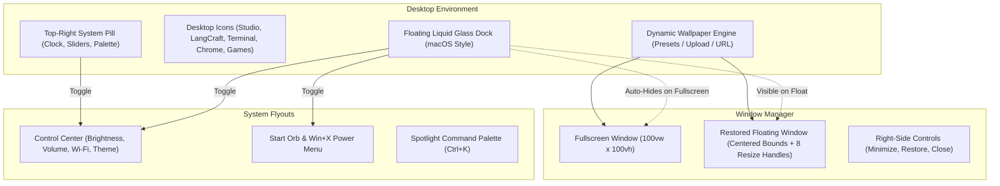
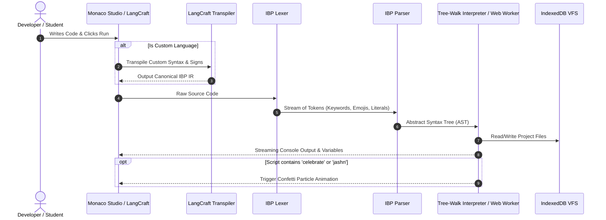

# 🪐 IBP OS: Educational Virtual Operating System & Custom Programming Language Workbench

```
  ██╗██████╗ ██████╗      ██████╗ ███████╗
  ██║██╔══██╗██╔══██╗    ██╔═══██╗██╔════╝
  ██║██████╔╝██████╔╝    ██║   ██║███████╗
  ██║██╔══██╗██╔═══╝     ██║   ██║╚════██║
  ██║██████╔╝██║         ╚██████╔╝███████║
  ╚═╝╚═════╝ ╚═╝          ╚═════╝ ╚══════╝
   The Human-First Programming Language & Browser Operating System
```

[](https://github.com/metad/ibp-os)
[](https://www.typescriptlang.org/)
[](https://opensource.org/licenses/MIT)
[](https://vitejs.dev/)
[](https://github.com/metad/ibp-os)
[](https://github.com/metad/ibp-os)
[](https://github.com/metad/ibp-os)

> **Create your own programming language from scratch in your browser.**  
> **IBP OS** is an educational operating system and language workbench. It combines a human-first programming language (supporting **English, Hinglish, Physics, and Advanced Mathematics**) with **LangCraft Studio**—an interactive engine to design custom syntax rules, punctuation signs (`<>:}?>()`), block delimiters, and logic systems. Download your language's complete **PDF Rulebook**, run it natively inside IBP OS, or download the **`ibpcompiler` CLI** and **VS Code Starter Kit** to execute your custom language on your PC!

---

<!-- SEO KEYWORDS & DISCOVERY METADATA -->
<!-- 
Keywords: create your own programming language, custom programming language creator, language workbench, build a programming language in browser, ebnf grammar generator, custom syntax rules, punctuation signs language designer, hinglish programming language, educational programming language, webos, browser operating system, ibpcompiler, vs code custom language compiler, transpiler, zero comma programming language, monaco editor browser ide, client-side virtual machine, physics calculation engine.
-->

## 📑 Table of Contents

1. [🌟 System Highlights & Key Features](#-system-highlights--key-features)
2. [🛠️ Custom Language Engine: LangCraft Studio](#️-custom-language-engine-langcraft-studio)
   - [Punctuation & Signs Design Matrix (`<>:}?>()`)](#punctuation--signs-design-matrix)
   - [Block Delimiters, Semicolons & Comma Policies](#block-delimiters-semicolons--comma-policies)
   - [Custom Standard Library & Formula Builder](#custom-standard-library--formula-builder)
   - [Keyword & Vocabulary Remapping](#keyword--vocabulary-remapping)
   - [Step-by-Step Tutorial: Designing Your Language](#step-by-step-tutorial-designing-your-language)
3. [📖 Exporting Language Rulebooks (PDF & Markdown)](#-exporting-language-rulebooks-pdf--markdown)
4. [💻 Standalone `ibpcompiler` & VS Code Starter Kit](#-standalone-ibpcompiler--vs-code-starter-kit)
5. [🪐 Running Custom Languages in IBP OS](#-running-custom-languages-in-ibp-os)
6. [🇮🇳 Hinglish Programming Language](#-hinglish-programming-language)
7. [📐 Mathematics, Physics & Smart Logic Engine](#-mathematics-physics--smart-logic-engine)
8. [🎨 Liquid Glass UI & Desktop Architecture](#-liquid-glass-ui--desktop-architecture)
9. [🖥️ Built-In Applications Suite](#️-built-in-applications-suite)
10. [🏗️ Architectural & Compiler Pipeline](#️-architectural--compiler-pipeline)
11. [💾 Virtual File System (VFS) & Offline Bundler](#-virtual-file-system-vfs--offline-bundler)
12. [🚀 Getting Started & Local Setup](#-getting-started--local-setup)
13. [📜 Available Scripts & Verification](#-available-scripts--verification)
14. [📄 License](#-license)

---

## 🌟 System Highlights & Key Features

```
┌──────────────────────────────────────────────────────────────────────────────┐
│                              IBP OS CAPABILITIES                             │
├─────────────────────────┬──────────────────────────┬─────────────────────────┤
│ 🛠️ LANGCRAFT WORKBENCH   │ 📖 PDF RULEBOOK EXPORT   │ 💻 STANDALONE COMPILER  │
│ Design custom languages │ Download A4 print-ready  │ Run on PC via VS Code   │
│ with custom signs/rules │ language specification   │ and `ibpcompiler.js`    │
├─────────────────────────┼──────────────────────────┼─────────────────────────┤
│ 🇮🇳 HINGLISH RUNTIME     │ 📐 ADVANCED MATH/PHYSICS │ 💬 INTERACTIVE REPL/CLI │
│ bolo, rakho, agar,      │ Free fall, kinetic       │ Live `ask` input,       │
│ tareeka, de_do, jashn   │ energy, vec2, clamp      │ streaming worker output │
├─────────────────────────┼──────────────────────────┼─────────────────────────┤
│ 💎 LIQUID GLASS UI      │ 🖥️ MULTI-WINDOW DESKTOP  │ 📦 RUN OFFLINE (ZIP)    │
│ Refractive frosted glass│ Windows titlebar right   │ Download & execute OS   │
│ & dynamic light mode    │ controls & floating mode │ client-side offline     │
└─────────────────────────┴──────────────────────────┴─────────────────────────┘
```

- **Custom Programming Language Designer (LangCraft Studio)**: Design, test, and compile complete programming languages in minutes without compiler boilerplate.
- **Total Punctuation & Syntax Sign Customization**: Decide where and how punctuation signs (`< > : { } [ ] ( ) ; = := -> => |> >> :: $ @ # // -- ;;`) are used.
- **Downloadable PDF Language Rulebooks**: One-click generation of beautifully formatted, publication-ready A4 PDF specifications containing your grammar, syntax rules, signs matrix, and keyword dictionary.
- **Standalone `ibpcompiler` & VS Code Starter Kit**: Run custom languages locally on your PC using the included `ibpcompiler.js` CLI runner, or press `Ctrl+Shift+B` in VS Code.
- **Natural English & Hinglish Execution**: Code in English (`say`, `keep`, `when`, `recipe`) or Hinglish (`bolo`, `rakho`, `agar`, `tareeka`, `de_do`, `jashn`).
- **Interactive Terminal & Monaco Studio**: Live user input via `ask`, live streaming outputs, resilient error diagnostics, and Web Worker thread isolation.
- **Physics & Advanced Mathematics**: Inbuilt kinematics, trigonometry, vectors (`vec2`), free fall simulations (`freeFall`), kinetic energy, force, and physical constants.
- **Liquid Glass Interface & Adaptive Themes**: High-refraction blur, specular lighting, responsive 8-handle resizable windows, and seamless Light/Dark themes.

---

## 🛠️ Custom Language Engine: LangCraft Studio

**LangCraft Studio** turns you into a programming language creator. Design custom syntax, punctuation rules, block delimiters, standard library formulas, and keywords—then execute code live with instant transpilation!

```
+──────────────────────────────────────────────────────────────────────────────+
│                       LANGCRAFT STUDIO WORKBENCH                             │
+──────────────────────────────────────────────────────────────────────────────+
│ 1. SIGNS & PUNCTUATION DESIGN ENGINE                                         │
│    • Block Delimiters:  { }  |  indent :  |  karo...bas  |  begin...end      │
│    • Statement End:     Newline (clean)  |  Semicolon ;  |  Colon :          │
│    • Call Wrappers:     fn(a, b)  |  fn[a, b]  |  fn<a, b>  |  fn a b        │
│    • List Brackets:     [1, 2, 3] |  (1, 2, 3) |  <1, 2, 3> |  {1, 2, 3}     │
│    • Member Access:     obj.prop  |  obj->prop |  obj::prop |  val |> fn()   │
│                                                                              │
│ 2. COMMA STRICTNESS POLICY                                                   │
│    • Zero-Comma:        jodo 10 20  |  list 1 2 3 4 5                        │
│    • Optional:          sum(10, 20) or sum(10 20)                            │
│    • Strict:            sum(10, 20) required                                 │
│                                                                              │
│ 3. OPERATORS & DECLARATIONS                                                  │
│    • Assignment:        = , := , <- , equals                                 │
│    • Variable Mode:     keyword-based (rakho x = 5) or auto-assign (x = 5)   │
│    • Logic Operators:   and / && / aur , or / || / ya , not / ! / mat        │
│                                                                              │
│ 4. CUSTOM STANDARD LIBRARY FORMULAS                                          │
│    • Define mathematical formulas, physics models, or business logic:        │
│      recipe varg(x) => x * x                                                 │
│      recipe kineticEnergy(m, v) => 0.5 * m * v * v                           │
│                                                                              │
│ 5. EXPORT & RUNTIME TARGETS                                                  │
│    • 📖 Download PDF Rulebook  • 💻 Download ibpcompiler.js CLI             │
│    • 📦 Download VS Code Zip   • 🪐 Open in IBP Studio / Terminal           │
+──────────────────────────────────────────────────────────────────────────────+
```

### Punctuation & Signs Design Matrix

Customize the exact signs and punctuation marks used in your language:

| Syntax Feature | Configurable Signs & Delimiters | Examples | Description |
|---|---|---|---|
| **Block Structure** | `{ ... }`, `indent (:)`, `karo...bas`, `begin...end`, `do...done` | `agar x > 0 karo ... bas` | Encloses conditional bodies, loops, and functions |
| **Statement Separator** | `none` (Newline), `;` (Semicolon), `:` (Colon) | `count = 1;` or `say "hi"` | Statement boundary marker (`optional` or `strict`) |
| **Function Call Sign** | `( ... )`, `[ ... ]`, `< ... >`, `whitespace` | `calc(a, b)` vs `calc<a, b>` | Wraps parameters passed into recipes/functions |
| **List / Array Sign** | `[ ... ]`, `( ... )`, `< ... >`, `{ ... }` | `[10, 20, 30]` vs `<10, 20, 30>` | Collection literal constructor |
| **Member Access Sign** | `.` (Dot), `->` (Arrow), `::` (Scope), `\|>` (Pipe) | `player.score` vs `player->score` | Field inspection or function chaining |
| **Quotes & Strings** | Double `"..."`, Single `'...'`, Backticks `` `...` ``, or Both | `"Hello"` vs `'Hello'` | String literal delimiter |
| **Assignment Sign** | `=`, `:=`, `<-`, `equals` | `rakho x = 10` or `x := 10` | Stores computed values in memory |
| **Logical AND** | `and`, `&&`, `aur`, `&` | `isReady and isOnline` | Boolean conjunction operator |
| **Logical OR** | `or`, `\|\|`, `ya`, `\|` | `isAdmin or isSuper` | Boolean disjunction operator |
| **Logical NOT** | `not`, `!`, `mat`, `~` | `not isBlocked` | Unary boolean inversion |
| **Comments** | `#`, `//`, `--`, `;;` | `# My custom comment` | Discarded single-line annotations |

---

### Block Delimiters, Semicolons & Comma Policies

LangCraft allows you to configure exact grammar strictness:
- **Zero-Comma Languages (`forbidden`)**: Commas are completely eliminated. Function arguments and arrays are delimited by natural whitespace:
  ```python
  jodo 10 20
  rakho primes = [2 3 5 7 11 13]
  ```
- **Optional Commas (`optional`)**: Write code with or without commas—both are accepted seamlessly.
- **Strict Commas (`strict`)**: Requires clean, explicit comma separators between all items.

---

### Custom Standard Library & Formula Builder

Inject domain-specific logic and mathematical formulas into your custom language without writing parser extensions:
- **`varg(x)`** $\to$ `x * x` (Calculates the square of a number)
- **`kineticEnergy(mass, velocity)`** $\to$ `0.5 * mass * velocity * velocity`
- **`hypotenuse(a, b)`** $\to$ `sqrt(a * a + b * b)`
- **`discount(price, pct)`** $\to$ `price - (price * pct / 100)`

---

### Keyword & Vocabulary Remapping

Every statement, loop, and keyword can be mapped to any word, regional language, or emoji:

```json
{
  "keywords": {
    "say": "bolo",
    "shout": "chillao",
    "whisper": "dhire",
    "ask": "pucho",
    "keep": "rakho",
    "lock": "pakka",
    "when": "agar",
    "orwhen": "warna_agar",
    "otherwise": "warna",
    "repeat": "dohrao",
    "times": "baar",
    "while": "jabtak",
    "recipe": "tareeka",
    "give": "de_do",
    "yes": "haan",
    "no": "nahi",
    "celebrate": "jashn"
  }
}
```

---

### Step-by-Step Tutorial: Designing Your Language

#### Step 1: Open LangCraft Studio
Launch **LangCraft Studio** from the IBP OS desktop, dock, or Spotlight search (`Ctrl+K`).

#### Step 2: Configure Rules & Punctuation Signs
1. Navigate to **Custom Logic & Syntax Rules**:
   - Set **Block Delimiter Style** to `Word Pairs (e.g. karo...bas)`.
   - Set **Statement Separators** to `Optional Semicolons (;)`.
   - Set **Comma Policy** to `Zero Commas (Space-separated)`.
   - Select your preferred signs for calls, lists, and logic operators.
2. In **Keywords & Vocabulary**, assign your custom words.
3. In **Standard Library**, register custom formulas.

#### Step 3: Test Live in the Interactive IDE
Write code in your new language and click **Run**:
```python
# BoloLang: Zero commas, karo...bas blocks, custom math
rakho player = "Ishant"
pakka LEVEL = 10

bolo "Namaste {player}! Welcome to your custom language."

rakho square_val = varg(5)
bolo "5 squared is:" square_val

agar LEVEL >= 10 karo
  chillao "Mastery Unlocked!"
  jashn
bas warna karo
  bolo "Keep practicing!"
bas
```

---

## 📖 Exporting Language Rulebooks (PDF & Markdown)

LangCraft Studio includes an automated **Language Rulebook Generator**:

```
+──────────────────────────────────────────────────────────────────────────────+
│                   LANGUAGE SPECIFICATION & RULEBOOK (A4)                     │
+──────────────────────────────────────────────────────────────────────────────+
│ 1. ARCHITECTURAL PHILOSOPHY & METADATA                                       │
│    • Language Name, Author, Paradigms & Version Tag                          │
│                                                                              │
│ 2. COMPLETE PUNCTUATION & SIGNS REFERENCE MATRIX                             │
│    • Blocks, Terminators, Call Wrappers, Lists, Member Access, Quotes        │
│                                                                              │
│ 3. COMPLETE KEYWORD VOCABULARY DICTIONARY                                    │
│    • Canonical Meaning, Custom Keyword, Category (I/O, State, Control)       │
│                                                                              │
│ 4. BUILT-IN STANDARD LIBRARY FORMULAS                                        │
│    • Signatures, mathematical expressions, and docstrings                    │
│                                                                              │
│ 5. CANONICAL SAMPLE CODE                                                     │
│    • Working idiomatic examples showing features in action                   │
│                                                                              │
│ 6. FORMAL EBNF GRAMMAR SPECIFICATION                                         │
│    • Production rules ready for parser generators & academic handbooks       │
+──────────────────────────────────────────────────────────────────────────────+
```

### Export Formats
- **Download Language Rulebook (PDF)**: Launches the print-to-PDF dialog formatted specifically for A4 paper (`@page { size: A4 }`), complete with title banner, syntax tables, and syntax-highlighted code blocks.
- **Download Rulebook (.md)**: Exports a clean GitHub-flavored markdown document to include directly in your language repository.

---

## 💻 Standalone `ibpcompiler` & VS Code Starter Kit

You don't need to stay inside the browser! LangCraft Studio enables you to export your language for local PC development:

### 1. Download `ibpcompiler.js` CLI
Click **"Download ibpcompiler.js"** to obtain a zero-dependency, standalone Node.js compiler and runtime script.

#### Command Line Reference:
```bash
# Execute your custom language code interactively
node ibpcompiler.js program.lang

# Compile custom syntax to canonical IBP IR and print to stdout
node ibpcompiler.js program.lang --compile

# Compile and save to an output file
node ibpcompiler.js program.lang -o dist/app.ibp

# Run using an external language specification JSON
node ibpcompiler.js program.lang --spec my_spec.json

# View help and version
node ibpcompiler.js --help
```

### 2. Download VS Code Starter Kit (.zip)
Click **"Download VS Code Starter Kit (.zip)"** to receive a complete, ready-to-run development project:
- **`ibpcompiler.js`**: Standalone compiler and runtime.
- **`<name>_spec.json`**: Complete language definition.
- **`sample.<ext>`**: Starter program written in your custom language.
- **`package.json`**: npm run scripts (`npm run run`, `npm run compile`).
- **`.vscode/tasks.json`**: Pre-configured build task—press **`Ctrl+Shift+B`** in VS Code to run your code instantly!
- **`.vscode/launch.json`**: Debug launcher—press **`F5`** to execute in the VS Code terminal.
- **`README.md`**: Step-by-step instructions for getting started.

---

## 🪐 Running Custom Languages in IBP OS

You can run and manage your custom languages directly within IBP OS:
1. **Save Spec to VFS**: Saves your language definition directly into `IBP://USERS/guest/languages/<name>.lang.json`.
2. **Create Project & Open in Studio**: Generates a project file in `IBP://USERS/guest/projects/` and opens it in **IBP Studio** with syntax checks and live VM execution.
3. **Run in Terminal**: Open the IBP OS Command Prompt / Terminal and execute your scripts:
   ```bash
   ibp run /users/guest/projects/my_project.ibp
   ```

---

## 🇮🇳 Hinglish Programming Language

IBP is the world's first educational computing platform featuring native, built-in **Hinglish keyword aliases**:

| English Keyword | Hinglish Keyword | Purpose | Code Example |
|---|---|---|---|
| `say` | `bolo`, `batao`, `likho` | Print to standard output | `bolo "Namaste World"` |
| `shout` | `chillao` | Print text in UPPERCASE | `chillao "shabash!"` |
| `whisper` | `dhire` | Print text in lowercase | `dhire "SECRET KEY"` |
| `ask` | `pucho` | Prompt user for input | `pucho "Apna naam batao:" into naam` |
| `keep` | `rakho`, `banao` | Declare mutable variable | `rakho score = 100` |
| `lock` | `pakka`, `fix` | Declare immutable constant | `pakka PI = 3.14159` |
| `when` | `agar` | Conditional branch | `agar score > 50: { ... }` |
| `orwhen` | `warna_agar` | Else-if condition | `warna_agar score == 50: { ... }`|
| `otherwise` | `warna` | Else fallback | `warna: { ... }` |
| `repeat N times`| `dohrao N baar` | Count-controlled iteration | `dohrao 3 baar: { ... }` |
| `while` | `jabtak` | Condition-controlled loop | `jabtak x > 0: { ... }` |
| `recipe` | `tareeka`, `vidhi` | Define a function / procedure | `tareeka jod(a, b) { de_do a + b }` |
| `give` | `de_do`, `wapas` | Return value from recipe | `de_do result` |
| `yes` / `no` | `haan` / `nahi` | Boolean literals | `rakho active = haan` |
| `celebrate` | `jashn`, `taali` | Fires celebratory confetti! | `jashn` |

---

## 📐 Mathematics, Physics & Smart Logic Engine

IBP includes an integrated mathematics and physics calculation engine:

### 1. Physics Engine
- `GRAVITY`: Earth's gravitational acceleration ($9.80665 \text{ m/s}^2$).
- `SPEED_OF_LIGHT`: $299,792,458 \text{ m/s}$.
- `force(mass, acceleration)`: Calculates $F = m \times a$ in Newtons.
- `kineticEnergy(mass, velocity)`: Calculates $KE = \frac{1}{2} m v^2$ in Joules.
- `potentialEnergy(mass, height, g)`: Calculates $PE = m g h$ in Joules.
- `freeFall(seconds, g)`: Simulates gravitational free fall, returning `{ distance, velocity }`.

### 2. Trigonometry & Vector Coordinates
- `sin(rad)`, `cos(rad)`, `tan(rad)`: Standard trigonometric functions.
- `degToRad(deg)`, `radToDeg(rad)`: Degree/Radian unit conversions.
- `vec2(x, y)`: Constructs a 2D coordinate box `{ x, y }`.
- `distance(x1, y1, x2, y2)` or `distance(p1, p2)`: Euclidean distance.
- `lerp(start, end, t)`: Linear interpolation between two numeric points.
- `clamp(val, min, max)`: Constrains a number within specified bounds.
- `percent(part, total)`: Calculates accurate percentages.

---

## 🎨 Liquid Glass UI & Desktop Architecture

IBP OS features an interface inspired by modern fluid glass aesthetics ([vue-web-liquid-glass](https://github.com/mkj0kjay/vue-web-liquid-glass)):



### Windows 11 Titlebar Controls & Sizing
- Positioned on the **right side** of every window:
  - **Sliders**: One-click toggle for the system Control Center.
  - **SunMoon**: Instant Light / Dark mode toggle.
  - **Minimize (`-`)**: Minimizes the window to the dock with smooth spring animations.
  - **Maximize / Restore (`Square` / `Copy`)**: Toggles between $100\text{vw} \times 100\text{vh}$ full-screen and centered floating mode.
  - **Close (`X`)**: Closes the application with a Windows-style red accent hover (`#E81123`).
- **8-Axis Dynamic Resizing**: Drag any border or corner in restored floating mode to comfortably adjust the window size.

---

## 🖥️ Built-In Applications Suite

| Application | Description |
|---|---|
| **LangCraft Studio** | Full-stack custom language workbench for designing, testing, and exporting personal programming languages with custom punctuation and rules. |
| **IBP Studio** | Code editor powered by Monaco Editor with syntax highlighting, live error carets, interactive console, virtual clock speed control, and variable inspector. |
| **Command Prompt / Terminal** | Interactive shell with command history (`↑`/`↓`), real file manipulation (`ls`, `cat`, `mkdir`, `rm`), and interactive IBP runner (`ibp run <path>`). |
| **Chrome Inbuilt Browser** | Virtual web client featuring tab management, omnibox navigation, and interactive previews for Zenzy Store and Ishant Portfolio. |
| **Arcade Games** | Suite of responsive retro games (Cyber Snake 60 FPS, Neon Pong, Memory Cards, 2048) running within the OS. |
| **File Explorer** | Windows-style hierarchical file explorer managing files and directories under `IBP://USERS/guest/`. |
| **Learn IBP Handbook** | 12-chapter interactive textbook with printable zero-dependency PDF export. |
| **System Monitor** | Real-time VM telemetry, heap utilization, active processes, and CPU frequency indicators. |
| **Playground** | 20 progressive coding puzzles with automated unit tests and XP reward tiers. |
| **Settings** | Personalization center for wallpapers, font scaling, sound effects, blur, and brightness. |

---

## 🏗️ Architectural & Compiler Pipeline



---

## 💾 Virtual File System (VFS) & Offline Bundler

IBP OS includes a client-side virtual filesystem backed by **IndexedDB (Dexie.js)**:

- **Root Structure**:
  - `IBP://USERS/guest/projects/`: User scripts and programs.
  - `IBP://USERS/guest/languages/`: Exported custom language blueprints (`.json`).
  - `IBP://SYSTEM/`: System configurations and environment files.
- **Offline ZIP Bundler**:
  Clicking **"Download Offline OS (ZIP)"** in the Control Center or Start Menu packages the HTML, JS, CSS, fonts, and starter projects into a single portable `.zip` file using `JSZip`, allowing the OS to run completely offline without an internet connection.

---

## 🚀 Getting Started & Local Setup

### Prerequisites
- **Node.js** 18+ or 20+
- **npm** or **pnpm**

### Installation
```bash
# Clone the repository
git clone https://github.com/metad/ibp-os.git
cd ibp-os

# Install workspace dependencies
npm install
```

### Running the Monorepo
```bash
# Start the web client development server
npm run dev

# Run all automated test suites across all packages
npm run test

# Validate TypeScript across all monorepo workspaces
npm run typecheck

# Build the complete production application
npm run build

# Start local production preview server
npm run preview --workspace=@ibp/web
```

---

## 📜 Available Scripts & Verification

| Command | Action | Status |
|---|---|---|
| `npm run test` | Runs Vitest across all 20 test suites | **155/155 passing** |
| `npm run typecheck` | Validates TypeScript across all workspaces | **0 errors** |
| `npm run build` | Builds `@ibp/engine`, `@ibp/language`, `@ibp/vfs`, `@ibp/vm`, `@ibp/web` | **Production Ready** |
| `npm run preview` | Runs local production preview server at `http://localhost:5173/` | **Ready** |

---

## 📄 License

Distributed under the **MIT License**. Engineered as an educational computing and language design platform.
