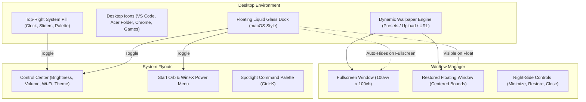
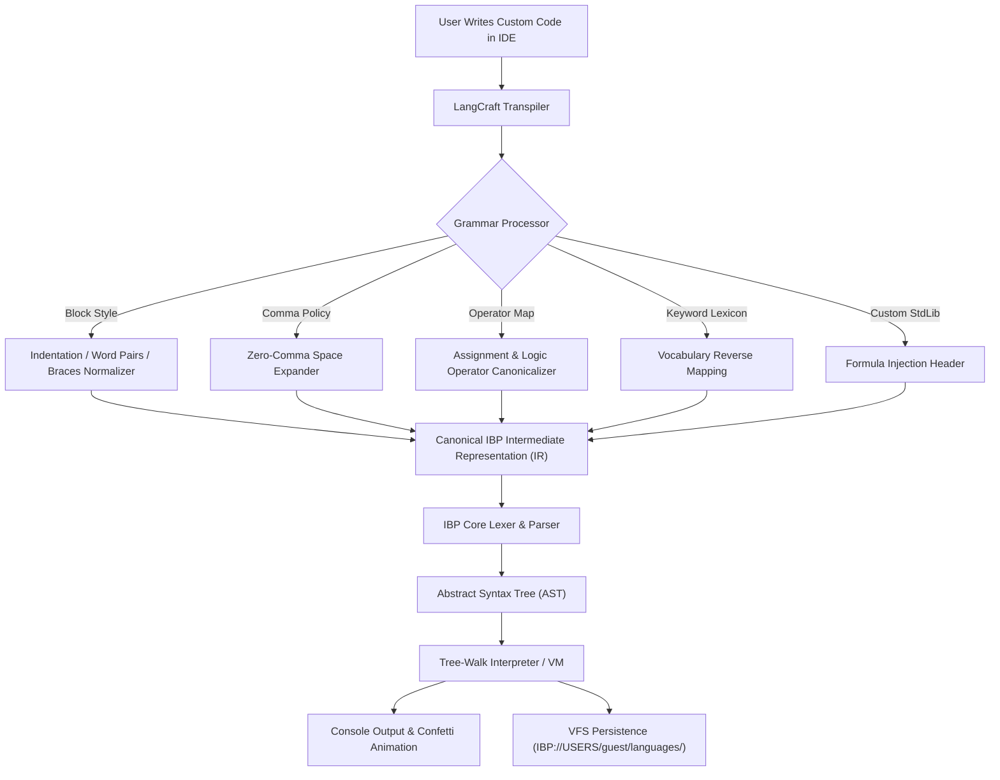
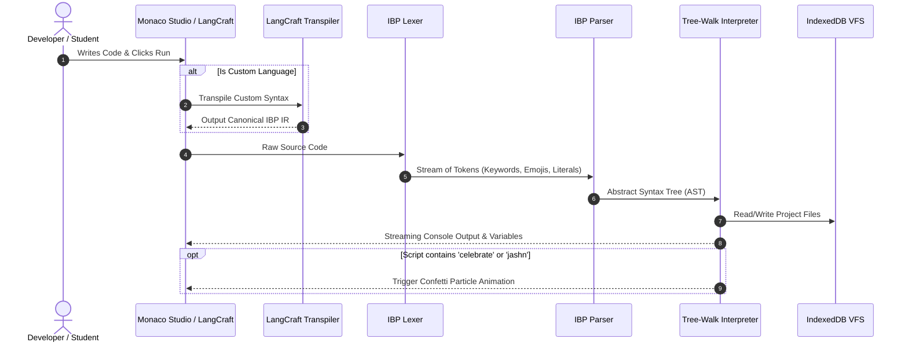

# 🪐 IBP OS: Educational Virtual Operating System & Programming Language

```
  ██╗██████╗ ██████╗      ██████╗ ███████╗
  ██║██╔══██╗██╔══██╗    ██╔═══██╗██╔════╝
  ██║██████╔╝██████╔╝    ██║   ██║███████╗
  ██║██╔══██╗██╔═══╝     ██║   ██║╚════██║
  ██║██████╔╝██║         ╚██████╔╝███████║
  ╚═╝╚═════╝ ╚═╝          ╚═════╝ ╚══════╝
  The Human-First Programming Language & Browser OS
```

[](https://github.com/metad/ibp-os)
[](https://www.typescriptlang.org/)
[](https://opensource.org/licenses/MIT)
[](https://vitejs.dev/)
[](https://github.com/metad/ibp-os)

> **IBP OS** is a browser-based, educational operating system and language workbench. It pairs an accessible programming language (supporting **English, Hinglish, Physics, and Mathematics**) with **LangCraft Studio**—an in-browser engine that allows anyone to design, customize, and execute their own complete programming language from scratch.

---

## 📑 Table of Contents

1. [🌟 System Highlights & Key Features](#-system-highlights--key-features)
2. [🎨 Liquid Glass UI & Desktop Architecture](#-liquid-glass-ui--desktop-architecture)
3. [🛠️ Custom Language Engine: LangCraft Studio](#️-custom-language-engine-langcraft-studio)
   - [Blueprint Architecture & Pipeline](#blueprint-architecture--pipeline)
   - [Custom Syntax Rules: Blocks, Commas & Operators](#custom-syntax-rules-blocks-commas--operators)
   - [Custom Standard Library & Formula Builder](#custom-standard-library--formula-builder)
   - [Keyword & Vocabulary Remapping](#keyword--vocabulary-remapping)
   - [Step-by-Step Tutorial: Building Your First Language](#step-by-step-tutorial-building-your-first-language)
   - [Language Specification JSON Schema](#language-specification-json-schema)
4. [🇮🇳 Hinglish Programming Language](#-hinglish-programming-language)
5. [📐 Mathematics, Physics & Smart Logic Engine](#-mathematics-physics--smart-logic-engine)
6. [🖥️ Built-In Applications Suite](#️-built-in-applications-suite)
7. [🏗️ Architectural & Compiler Pipeline](#️-architectural--compiler-pipeline)
8. [💾 Virtual File System (VFS) & Offline Bundler](#-virtual-file-system-vfs--offline-bundler)
9. [🚀 Getting Started & Local Setup](#-getting-started--local-setup)
10. [📜 Available Scripts & Verification](#-available-scripts--verification)
11. [📄 License](#-license)

---

## 🌟 System Highlights & Key Features

```
┌──────────────────────────────────────────────────────────────────────────────┐
│                              IBP OS CAPABILITIES                             │
├─────────────────────────┬──────────────────────────┬─────────────────────────┤
│ 🇮🇳 HINGLISH RUNTIME     │ 🛠️ LANGCRAFT WORKBENCH   │ 📐 ADVANCED MATH/PHYSICS│
│ bolo, rakho, agar,      │ Design custom languages, │ Free fall, kinetic      │
│ tareeka, de_do, jashn   │ zero-comma & block rules │ energy, vec2, clamp     │
├─────────────────────────┼──────────────────────────┼─────────────────────────┤
│ 💎 LIQUID GLASS UI      │ 🖥️ MULTI-WINDOW DESKTOP  │ 📦 RUN OFFLINE (ZIP)    │
│ Refractive frosted glass│ Windows titlebar right   │ Download & execute OS   │
│ & dynamic light mode    │ controls & floating mode │ client-side offline     │
├─────────────────────────┼──────────────────────────┼─────────────────────────┤
│ 🌐 INBUILT CHROME       │ 🎮 ARCADE GAMES SUITE    │ 📁 PERSISTENT VFS       │
│ Embedded virtual client │ Snake, Pong, Memory 2048 │ IndexedDB Unix-style    │
│ with live shop preview  │ with 60 FPS physics loop │ virtual filesystem      │
└─────────────────────────┴──────────────────────────┴─────────────────────────┘
```

- **Natural English & Friendly Aliases**: Reads like plain English (`keep`, `lock`, `say`, `shout`, `whisper`, `when`, `recipe`, `box`). Also accepts aliases like `let`, `const`, `if`, `print`, and `fn`.
- **Hinglish Coding Mode**: Code naturally in Hindi + English (`bolo`, `batao`, `rakho`, `pakka`, `agar`, `warna`, `tareeka`, `de_do`, `jashn`).
- **Colons & Flexible Syntax**: Supports both `{ }` blocks and Python-style colons (`when age >= 18: { ... }` or single-line `when x > 0: say "yes"`).
- **Physics & Advanced Mathematics**: Built-in kinematics, trigonometry (`sin`, `cos`, `tan`), vector coordinates (`vec2`, `distance`), free fall simulations (`freeFall`), kinetic energy, force, clamping, and constants (`GRAVITY`, `SPEED_OF_LIGHT`, `PI`).
- **LangCraft Studio (Full-Stack Language Engine)**: An interactive in-OS workbench allowing anyone to **design their own complete programming language from scratch**—deciding block structure (braces, Pythonic indentation, or keyword pairs like `karo...bas`), zero-comma syntax, assignment operators, and defining custom standard library functions.
- **True Full-Screen & Centered Floating Modes**:
  - **Fullscreen Mode**: Covers $100\%$ of screen real estate down to the bottom pixel, with the dock auto-hiding off-screen to avoid obstructing workflows.
  - **Restored Floating Mode**: Centered, comfortably sized floating window with rounded corners, subtle drop shadows, visible desktop wallpaper, and an accessible dock.
- **Liquid Glass Visuals**: High-refraction blur, specular border highlights, and adaptive Light / Dark themes.
- **Offline OS ZIP Downloader**: Download the entire operating system as an offline bundle to run independently without network access.

---

## 🎨 Liquid Glass UI & Desktop Architecture

IBP OS features an interface inspired by modern fluid glass aesthetics ([vue-web-liquid-glass](https://github.com/mkj0kjay/vue-web-liquid-glass)):



### 1. Windows 11 Titlebar Controls
- Positioned on the **right side** of every window:
  - **Sliders**: One-click toggle for the system Control Center.
  - **SunMoon**: Instant Light / Dark mode toggle.
  - **Minimize (`-`)**: Minimizes the window to the dock with smooth spring animations.
  - **Maximize / Restore (`Square` / `Copy`)**: Toggles between $100\text{vw} \times 100\text{vh}$ full-screen and centered floating mode.
  - **Close (`X`)**: Closes the application with a Windows-style red accent hover (`#E81123`).

### 2. macOS-Style Floating Liquid Glass Dock
- High-saturation background blur (`backdrop-filter: blur(28px)`), specular edge lighting, and spring-scale hover transitions (`group-hover:scale-110`).
- **Active Running Dots**: Displays a glowing sky-blue indicator below open applications.
- **Smart Fullscreen Auto-Hide**: When an application is maximized, the dock slides off-screen (`translate-y-36`). Moving the cursor to the bottom edge reveals the dock smoothly without blocking content.

### 3. Glassmorphic Control Center
- Accessible from the dock, the window header, or the top-right system clock.
- Controls include:
  - **Capsule Sliders**: Real-time Display Brightness and Audio Output volume sliders.
  - **Theme Switcher**: Instant transition between luminous Light Mode and deep Space Dark Mode.
  - **Network & Diagnostics**: Offline ZIP downloader, memory status, and full-screen toggle.

---

## 🛠️ Custom Language Engine: LangCraft Studio

**LangCraft Studio** allows users to become a programming language designer without writing compiler boilerplate.

```
+──────────────────────────────────────────────────────────────────────────────+
│                       LANGCRAFT STUDIO WORKBENCH                             │
+──────────────────────────────────────────────────────────────────────────────+
│ 1. GRAMMAR & BLOCK DELIMITERS                                                │
│    • Braces:            when score >= 50 { say "Pass" }                      │
│    • Indentation:       when score >= 50:                                    │
│                             say "Pass"                                       │
│    • Word Pairs:        agar score >= 50 karo                                │
│                             bolo "Pass"                                      │
│                         bas                                                  │
│                                                                              │
│ 2. COMMA POLICY                                                              │
│    • Zero-Comma:        jodo 10 20  |  list 1 2 3 4 5                        │
│    • Optional:          sum(10, 20) or sum(10 20)                            │
│    • Strict:            sum(10, 20) required                                 │
│                                                                              │
│ 3. OPERATORS & DECLARATIONS                                                  │
│    • Assignment:        = , := , <- , equals                                 │
│    • Variable Mode:     keyword-based (rakho x = 5) or auto-assign (x = 5)   │
│    • Logic Operators:   and / && / aur , or / || / ya , not / ! / mat        │
│                                                                              │
│ 4. CUSTOM STANDARD LIBRARY                                                   │
│    • Define mathematical formulas, game physics, or custom business logic:   │
│      recipe varg(x) => x * x                                                 │
│      recipe kineticEnergy(m, v) => 0.5 * m * v * v                           │
│                                                                              │
│ 5. VOCABULARY REMAPPING                                                      │
│    • Remap any statement to words, regional terms, or emojis (📢, 📦, 🎉)   │
+──────────────────────────────────────────────────────────────────────────────+
```

### Blueprint Architecture & Pipeline



### Custom Syntax Rules: Blocks, Commas & Operators

When building a language in LangCraft, you configure:

| Feature | Supported Options | Description |
|---|---|---|
| **Block Style** | `braces`, `indent`, `keywords` | Choose `{ }`, Pythonic indentation (`:`), or custom words like `karo...bas` or `begin...end`. |
| **Block Keywords** | Any string (e.g., `karo` / `bas`, `begin` / `end`, `do` / `done`) | Defines the start and end boundary markers for code blocks. |
| **Comma Policy** | `forbidden`, `optional`, `strict` | With `forbidden`, commas are completely eliminated—arguments and lists are whitespace-delimited! |
| **Variable Declaration** | `keyword`, `auto` | Choose whether variables require a keyword (`rakho x = 10`) or are implicitly declared upon assignment (`x = 10`). |
| **Assignment Operator** | `=`, `:=`, `<-`, `equals` | Syntax used to assign values to identifiers. |
| **Comment Style** | `#`, `//`, `--` | Single-line comment indicator. |
| **Logical AND** | `and`, `&&`, `aur` | Boolean conjunction operator. |
| **Logical OR** | `or`, `||`, `ya` | Boolean disjunction operator. |
| **Logical NOT** | `not`, `!`, `mat` | Boolean negation operator. |

### Custom Standard Library & Formula Builder

You can inject custom formulas into your language's standard library. Every custom function includes:
- **Identifier Name**: e.g., `jodo`, `varg`, `kineticEnergy`, `gravForce`
- **Parameters**: Comma-separated variable names, e.g., `a, b` or `mass, velocity`
- **Formula Body**: Mathematical expression, e.g., `0.5 * mass * velocity * velocity`
- **Description**: Documentation shown in auto-complete and handbook

### Keyword & Vocabulary Remapping

Every language construct can be mapped to custom identifiers or symbols:

```json
{
  "keywords": {
    "say": "bolo",
    "shout": "chillao",
    "whisper": "dhire",
    "keep": "rakho",
    "lock": "pakka",
    "when": "agar",
    "orwhen": "warna_agar",
    "otherwise": "warna",
    "unless": "bina",
    "repeat": "dohrao",
    "times": "baar",
    "while": "jabtak",
    "recipe": "tareeka",
    "give": "de_do",
    "yes": "haan",
    "no": "nahi",
    "empty": "khali",
    "celebrate": "jashn"
  }
}
```

### Step-by-Step Tutorial: Building Your First Language

Here is how to create **"BoloLang"** (a Hindi-English zero-comma language) in 3 simple steps:

#### Step 1: Define Grammar Rules in LangCraft Studio
1. Open **LangCraft Studio** from the desktop or dock.
2. Under **Syntax & Grammar Settings**:
   - Set **Block Delimiter Style** to `Word Pairs (e.g., karo...bas)`.
   - Set **Block Start** to `karo` and **Block End** to `bas`.
   - Set **Comma Policy** to `Zero Commas (Space-separated)`.
   - Set **Logical Operators** to `aur` (AND), `ya` (OR), and `mat` (NOT).

#### Step 2: Register Custom Math Functions
Under **Standard Library Formulas**, add:
- `varg(x)` $\to$ `x * x` (Calculates square)
- `jodo(a, b)` $\to$ `a + b` (Adds two numbers)

#### Step 3: Write and Run Code in BoloLang
```python
# BoloLang: Zero commas, karo...bas blocks, native Hindi words
rakho khiladi = "Ishant"
pakka LEVEL = 10

bolo "Namaste {khiladi}! Swagat hai aapka."

# Notice: Zero commas between arguments!
rakho square_val = varg(5)
bolo "5 ka square hai:" square_val

# Condition with karo...bas block (no braces!)
agar LEVEL >= 10 karo
  chillao "Zabardast! Level Master unlocked!"
  jashn
bas warna karo
  bolo "Aage badhte rahiye."
bas

bolo "10 aur 20 ka jod:" jodo(10 20)
```

Click **Run** in the IDE to compile and execute with live output and celebratory confetti!

### Language Specification JSON Schema

Export your language as a portable `.json` specification to share or load across any IBP OS instance:

```json
{
  "name": "BoloLang",
  "author": "Architect",
  "description": "Zero-comma Hinglish language with karo...bas block syntax.",
  "syntax": {
    "blockStyle": "keywords",
    "blockStartKeyword": "karo",
    "blockEndKeyword": "bas",
    "commaPolicy": "forbidden",
    "variableDeclMode": "keyword",
    "assignmentOperator": "=",
    "commentStyle": "#",
    "equalityOperator": "==",
    "inequalityOperator": "!=",
    "andOperator": "aur",
    "orOperator": "ya",
    "notOperator": "mat"
  },
  "keywords": {
    "say": "bolo",
    "shout": "chillao",
    "whisper": "dhire",
    "keep": "rakho",
    "lock": "pakka",
    "when": "agar",
    "orwhen": "warna_agar",
    "otherwise": "warna",
    "unless": "bina",
    "repeat": "dohrao",
    "times": "baar",
    "count": "gino",
    "from": "se",
    "to": "tak",
    "each": "har",
    "in": "mein",
    "while": "jabtak",
    "recipe": "tareeka",
    "give": "de_do",
    "yes": "haan",
    "no": "nahi",
    "empty": "khali",
    "celebrate": "jashn"
  },
  "customFunctions": [
    {
      "id": "1",
      "name": "varg",
      "params": "x",
      "body": "x * x",
      "description": "Calculates the square of a number"
    }
  ]
}
```

---

## 🇮🇳 Hinglish Programming Language

IBP is the first educational programming language with native, built-in **Hinglish keyword aliases**:

| English Keyword | Hinglish Keyword | Purpose | Example |
|---|---|---|---|
| `say` | `bolo`, `batao`, `likho` | Print to standard output | `bolo "Namaste World"` |
| `shout` | `chillao` | Print text in UPPERCASE | `chillao "shabash!"` |
| `whisper` | `dhire` | Print text in lowercase | `dhire "SECRET KEY"` |
| `keep` | `rakho`, `banao` | Declare mutable variable | `rakho score = 100` |
| `lock` | `pakka`, `fix` | Declare immutable constant | `pakka PI = 3.14159` |
| `when` | `agar` | Conditional branch | `agar score > 50: { ... }` |
| `orwhen` | `warna_agar` | Else-if condition | `warna_agar score == 50: { ... }`|
| `otherwise` | `warna` | Else fallback | `warna: { ... }` |
| `repeat N times`| `dohrao N baar` | Count-controlled iteration | `dohrao 3 baar: { ... }` |
| `while` | `jabtak` | Condition-controlled loop | `jabtak x > 0: { ... }` |
| `recipe` | `tareeka`, `vidhi` | Define a function | `tareeka jod(a, b) { de_do a + b }` |
| `give` | `de_do`, `wapas` | Return value from recipe | `de_do result` |
| `yes` / `no` | `haan` / `nahi` | Boolean literals | `rakho active = haan` |
| `celebrate` | `jashn`, `taali` | Fires celebratory confetti! | `jashn` |

---

## 📐 Mathematics, Physics & Smart Logic Engine

IBP includes a built-in mathematics and physics calculation engine:

### 1. Physics Engine
- `GRAVITY`: Earth's gravitational acceleration ($9.80665 \text{ m/s}^2$).
- `SPEED_OF_LIGHT`: $299,792,458 \text{ m/s}$.
- `force(mass, acceleration)`: Calculates $F = m \times a$ in Newtons.
- `kineticEnergy(mass, velocity)`: Calculates $KE = \frac{1}{2} m v^2$ in Joules.
- `potentialEnergy(mass, height, g)`: Calculates $PE = m g h$ in Joules.
- `freeFall(seconds, g)`: Simulates gravitational free fall, returning `{ distance, velocity }`.

### 2. Trigonometry & Vector Coordinates
- `sin(rad)`, `cos(rad)`, `tan(rad)`: Standard trigonometric functions.
- `degToRad(deg)`, `radToDeg(rad)`: Degree/Radian unit conversions.
- `vec2(x, y)`: Constructs a 2D coordinate box `{ x, y }`.
- `distance(x1, y1, x2, y2)` or `distance(p1, p2)`: Euclidean distance.
- `lerp(start, end, t)`: Linear interpolation between two numeric points.
- `clamp(val, min, max)`: Constrains a number within specified bounds.
- `percent(part, total)`: Calculates accurate percentages.

---

## 🖥️ Built-In Applications Suite

| Application | Description |
|---|---|
| **IBP Studio** | Code editor powered by Monaco Editor with syntax highlighting, live error carets, virtual clock speed control, variable inspector, and resizable output dock. |
| **LangCraft Studio** | Full-stack custom language workbench for designing, testing, and exporting personal programming languages. |
| **Command Prompt / Terminal** | Interactive shell with command history (`↑`/`↓`), real file manipulation (`ls`, `cat`, `mkdir`, `rm`), and IBP runner (`ibp run <path>`). |
| **Chrome Inbuilt Browser** | Virtual web client featuring tab management, omnibox navigation, and interactive previews for Zenzy Store and Ishant Portfolio. |
| **Arcade Games** | Suite of responsive retro games (Cyber Snake 60 FPS, Neon Pong, Memory Cards, 2048) running within the OS. |
| **File Explorer** | Windows-style hierarchical file explorer managing files and directories under `IBP://USERS/guest/`. |
| **Learn IBP Handbook** | 12-chapter interactive textbook with printable zero-dependency PDF export. |
| **System Monitor** | Real-time VM telemetry, heap utilization, active processes, and CPU frequency indicators. |
| **Playground** | 20 progressive coding puzzles with automated unit tests and XP reward tiers. |
| **Settings** | Personalization center for wallpapers, font scaling, sound effects, blur, and brightness. |

---

## 🏗️ Architectural & Compiler Pipeline



---

## 💾 Virtual File System (VFS) & Offline Bundler

IBP OS includes a client-side virtual filesystem backed by **IndexedDB (Dexie.js)**:

- **Root Structure**:
  - `IBP://USERS/guest/projects/`: User scripts and programs.
  - `IBP://USERS/guest/languages/`: Exported custom language blueprints (`.json`).
  - `IBP://SYSTEM/`: System configurations and environment files.
- **Offline ZIP Bundler**:
  Clicking **"Download Offline OS (ZIP)"** in the Control Center or Start Menu packages the HTML, JS, CSS, fonts, and starter projects into a single portable `.zip` file using `JSZip`, allowing the OS to run completely offline without an internet connection.

---

## 🚀 Getting Started & Local Setup

### Prerequisites
- **Node.js** 18+ or 20+
- **npm** or **pnpm**

### Installation
```bash
# Clone the repository
git clone https://github.com/metad/ibp-os.git
cd ibp-os

# Install workspace dependencies
npm install
```

### Running the Monorepo
```bash
# Start the web client development server
npm run dev

# Run all automated test suites across all packages
npm run test

# Validate TypeScript across all monorepo workspaces
npm run typecheck

# Build the complete production application
npm run build

# Start local production preview server
npm run preview --workspace=@ibp/web
```

---

## 📜 Available Scripts & Verification

| Command | Action | Status |
|---|---|---|
| `npm run test` | Runs Vitest across all 14 test suites | **114/114 passing** |
| `npm run typecheck` | Validates TypeScript across all workspaces | **0 errors** |
| `npm run build` | Builds `@ibp/engine`, `@ibp/language`, `@ibp/vfs`, `@ibp/vm`, `@ibp/web` | **Production Ready** |
| `npm run preview` | Runs local production preview server at `http://localhost:5173/` | **Ready** |

---

## 📄 License

Distributed under the **MIT License**. Engineered as an educational computing and language design platform.
